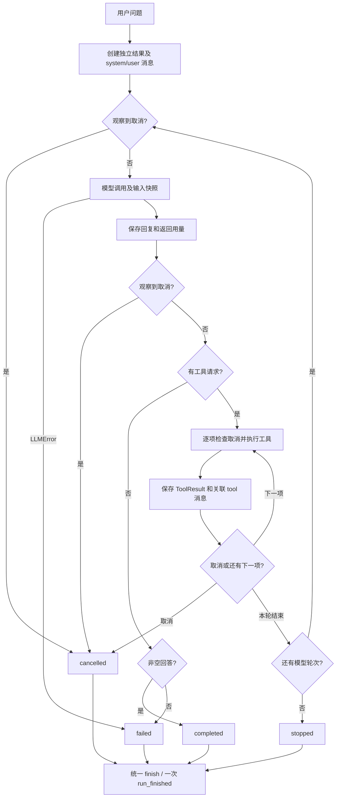

# Day 05 完成日志：Mini Agent v0

日期：2026-09-30。本文记录本次工程验收，不补造历史实验或真实 API 用量。

## 完成内容

- 保留用户已写的 MiniAgent 状态、详细结果、顺序工具循环、取消检查和旧 run() 二元组入口。
- Day 04 遗留测试已修复：缺参按“参数校验失败”契约检查；校验顺序测试实际 invoke，并以 handler 计数验证先校验再执行。
- 增加可复用的 scripted_model fixture，固定轮次、输入深拷贝、意外额外调用断言；保留原有学习测试。
- 补齐 [15 个固定案例](day-05-cases.md)，包含真实工具返回值、ID 关联、校验拒绝、执行错误、模型错误、步骤耗尽及取消。
- 补齐回调期间取消、异步工具等待期间取消、运行数据隔离、历史快照、观察回调副本和开发异常传播实验。
- 事件明确标记 mock 模式并保留模型类名；没有声明模式的自定义模型记为 unknown。
- 新增 trace.save_trace：JSONL 事件 + JSON 完整结果，UTF-8，UUID hex 文件名，拒绝重复覆盖及路径型 ID。
- 新增完整四场景演示；原 `day_05_agent_v0.py` 保留为兼容入口，已有 PyCharm 路径继续可运行。
- 更新课程完成状态，记录证据、工程边界和复盘讲解材料。

## 测试与运行证据

| 检查 | 本次实际结果 |
|---|---|
| 修改前 tools + mini_agent 基线 | 39 passed |
| 第一次新增相关回归 | 73 passed，1 个临时目录创建错误：data/day05 父目录尚不存在 |
| 创建输出目录后相关回归 | 74 passed in 3.47s |
| 增加 ask 兼容检查后独立验收文件 | 27 passed in 0.20s |
| 最终全项目回归 | 100 passed, 1 warning in 5.29s |
| Day 04 示例 | 成功场景 {"text":2}、非法 needle 的失败回传断言均通过 |
| 旧 CLI demo | 96.0；模型 2 次、工具 1 次；40 tokens 是 DemoModel 合成值 |
| CLI ask | mock 客户端自动化通过；未向真实 DeepSeek 发请求 |
| 新演示与旧文件名入口 | 均成功退出，四种终态与调用次数断言通过 |

最终命令及案例节点见 [day-05-cases.md](day-05-cases.md)。JUnit 结果为 `data/day05/pytest-final.xml`。
运行中修复的是测试目录准备问题，没有为让测试通过修改 Agent 业务行为。
唯一依赖 warning：Starlette 的 BlockingPortal 别名已弃用，可在后续依赖维护时处理。

## 数据流与状态



completed 只表示得到最终非空答复；工具失败被解释后仍可 completed。
failed 表示本课定义的模型服务错误或无效空回复；stopped 表示轮次预算耗尽；cancelled 表示观察到用户取消。
不要通过 answer 中是否有“失败”判断状态。

## 已导出的合成演示

以下是最终标准入口本次运行的真实 UUID，文件保存在本地忽略目录 `data/day05/`。

| 场景 | run_id | steps / 实际模型调用 / 工具请求 | 事件数 |
|---|---|---|---|
| completed | 943c440d34f44b2888342138d3082a07 | 2 / 2 / 1 | 8 |
| failed | f83db1be1a56447487e2705dc49b5eee | 1 / 1 / 0 | 3 |
| cancelled | 7b4fdb3e8b484c0a9a85676a9bf91060 | 1 / 1 / 1 | 6 |
| stopped | c5af04134ae64461bb3b474dde2803a0 | 3 / 3 / 3 | 14 |

文件命名为 `<run_id>.events.jsonl` 和 `<run_id>.result.json`。原始导出包含完整字段；下面是阅读用摘要，不伪称完整 JSONL。

成功轨迹：

```text
1 run_started      mock / ScenarioModel
2 model_started    第 1 轮输入 system + user
3 model_finished   请求 calc-1：calculator(expression="12 * 8")
4 tool_started     calc-1
5 tool_finished    {"ok":true,"content":96.0,"error":null}
6 model_started    第 2 轮包含 assistant/tool_calls + tool
7 model_finished   “计算结果是 96.0。”
8 run_finished     completed / final_answer
```

模型失败轨迹：

```text
1 run_started
2 model_started
3 run_finished     failed / model_error
  error.type       LLMError
  error.message    离线演示：模拟模型服务不可用
```

取消实验：第一轮提出 calculator 和 current_time；calculator 完成后回调设置取消；保留 96.0，time-1 没执行，也没有第二轮模型调用。
stopped 实验：三个 calc 结果都保存了，但第三份结果未被后续模型读取。

## 指标含义与边界

| 指标 | 定义 |
|---|---|
| steps | 本次已开始的 complete 尝试轮数，开始前取消为 0 |
| usage.model_calls | 累计成功返回的 ModelReply.usage，不保证包含抛错请求及客户端内部重试 |
| usage.tool_calls | 提交 Registry 的次数，未知工具和参数拒绝也计数 |
| handler 计数 | 测试层观察实际执行，不用工具事件数代替 |
| usage.elapsed_seconds | 模型客户端报告的累计请求耗时 |
| result.elapsed_seconds | 从 run_detailed 开始到进入 finish 的墙钟时间；不含终止回调和文件导出 |

mock Token 不是实际计费；服务故障没有返回 Usage 时，本次消耗未知，不能把累计值 0 解读为确定免费。
started 事件是准备执行：它的回调可取消操作，因此 started 数量可能大于实际操作数。
协作取消不强行中断正在等待的网络/工具，也不撤回副作用。在途工具实验用 asyncio.Event 控制时序，没有依赖随机 sleep。
外部 Task.cancel、开发错误、事件回调异常不保证有完整结果或 run_finished；不要吞掉它们伪装正常返回。
取消后可能有未配对的工具请求，当前不支持将它们直接恢复给模型。
导出为正常返回后落盘，不是检查点或崩溃恢复；写入错误直接报错，极端中断可能留下部分文件。
真实敏感输入没有自动脱敏功能。当前只导出公开合成问题，不保存 Settings、密钥或请求头。

## 第一周复盘材料

以下是根据已有笔记整理的讲解稿，不代替本人独立掌握程度的评估。

| 天数 | 主要主题 | 在 Day 05 中的作用 |
|---|---|---|
| Day 01 | 环境、消息、API 与基础 Agent | 知道入口、解释器、messages 和模型/工具的职责 |
| Day 02 | 模型客户端、错误分类、有限重试、结构化输出 | Agent 复用 LLMError 和 ModelReply，不重复做无限重试 |
| Day 03 | async/await、并发控制、超时与取消 | 理解逐个 await 是顺序执行，取消需要明确执行边界 |
| Day 04 | 工具注册、输入校验、结果封装 | 工具参数拒绝不执行 handler；ok=False 是可回传的数据 |
| Day 05 | 状态、轨迹、固定案例与运行终止 | 能检查为什么结束、已经做了什么、哪些操作没发生 |

3～5 分钟讲解稿：

1. 用户问题先变成 user 消息，Agent 附加 system 消息，创建独立的结果和 Usage。
2. 模型看到消息与工具定义，返回普通文本或 tool_calls；模型不直接执行 Python handler。
3. Registry 按名称找工具，Tool 用 Pydantic 校验；缺参/错类型在 handler 前失败，合法参数转成字典传入 handler。
4. 调用结果成功与否都封装为 ToolResult，再用原 call.id 写成 tool 消息。第二轮模型才能读取实际结果。
5. Agent 根据明确状态收尾：最终文本、空回复/模型错误、取消、轮次上限。每次正常返回只写一条终止事件。
6. 演示取消：第一项完成时设置标志，保存已有结果，跳过第二项并返回 cancelled；这不是撤销或强制中断。

## 口头自测参考答案

1. API 调用是一次 complete；Agent 循环会多次调用模型并执行工具。
2. 用户输入和模型消息在 messages；参数在 ToolCall.arguments 及 assistant.tool_calls；结果在 tool 消息和 tool_finished。
3. 第一轮提出工具请求，第二轮基于实际工具结果回答；普通答案可以只有一轮。
4. 工具失败不必使 Agent failed；可让模型读取失败结果并解释或提出修正。
5. completed 不等于所有用户目标都达成，假模型尤其不能证明回答质量。
6. 状态字段与 stop_reason 是契约，回复文字可能只是引用或解释失败。
7. max_steps 限模型轮次；T 统计工具请求；总耗时统计墙钟等待，三者不同。
8. 同一轮可能多个工具，回调和 await 期间都可能请求取消，所以每个执行边界需检查。
9. messages 是可变嵌套结构，浅引用会使历史输入随之后追加而变化；使用 deepcopy。
10. 脚本预设的正确回复不证明工具执行；必须检查 handler、Registry 和下一轮的 tool 消息。
11. 固定案例直接注入无网络的 ScriptedModel；ask 回归替换真实客户端；生产 API 未调用。
12. 网页搜索可作为注册工具进入 ToolRegistry；仍需输入校验、错误结果、用量与轨迹边界。

待本人确认：能否不看稿解释以上问题，特别是 started 与真实调用的区别、取消后未完成请求的含义，以及模型失败时 Usage 为何未知。

## 范围与后续

核心工程交付及自动化验收完成；学习者口头验收由本人完成。代码和日志按 Day 05 范围做本地 Git 提交，不推送。
保留 Day 01～04 日志、IDE 配置及其他未关联工作，不并入本次提交。
计划第 15 节的真实模型回归、CLI --trace、增量保存、工具超时、额外调用/输出预算作为可选后续，不计为本次核心完成项；没有产生真实 API 调用费用。
