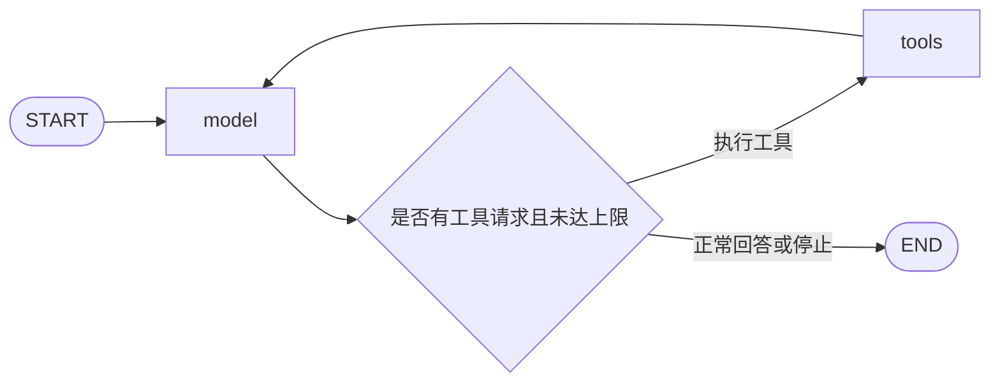
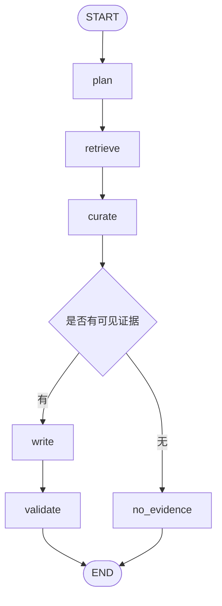

# Day 11：LangGraph 的 Graph、Node、State 与条件边——PyCharm 详细学习计划

> 项目：`E:\agent_project\agent-learning-lab`  
> 环境：PyCharm + 项目 `.venv` Python 3.11  
> 学习投入：当天总计 8 小时，各阶段弹性安排  
> 主线：普通函数 → 状态更新 → 节点与边 → 条件分支 → 有界工具循环 → 研究流程状态图

## 1. 对齐六周项目计划总览

今天进入第三周，对应总览“第 11 天：Graph、Node 和 State”，同时对齐 `curriculum/week-03.md` 的 StateGraph 任务。

| 总览要求 | 今日具体交付 |
|---|---|
| 完成 LangGraph Quickstart | 阅读官方示例，使用已有工具和 Mock 模型完成等价工具循环 |
| 定义 ResearchState | 阅读现有类型，给学习图补充明确字段与更新规则 |
| 模型调用、工具执行变成 Node | 独立 model/tools 节点与有限循环 |
| 条件边实现继续或结束 | 展示无工具、执行工具、达到上限、失败的不同路径 |
| 绘制状态图 | 工具循环图 + plan/retrieve/curate/write/validate 研究图 |
| 理解 Reducer | 覆盖与追加的对照、返回增量与全量的区别 |
| 观察状态变化 | ainvoke 获取结果，astream 查看节点更新 |
| 对照手写与框架 | 比较 Day 05 循环、当前单节点包装和拆分图 |
| 扩展 Functional API | 核心完成后选做，不同时重写两套实现 |

今天主要学习**谁做工作、数据怎样传递、接下来执行哪个节点**。研究计划质量留到 Day 12，并行分支留到 Day 13，检查点、恢复和取消在 Day 14 系统完成。

## 2. 今天最需要建立的认识

LangGraph 可以把你已经会写的 Python 函数组织成显式流程。节点内仍然需要正确的模型客户端、检索器、参数校验和错误处理。

从高级 Agent 工程师的角度，今天要检查：

1. **流程可读：**看到图就能找到每种正常、缺证据和失败路径。
2. **节点有边界：**每个节点读取什么、返回什么、是否产生外部调用都能列出来。
3. **状态有约定：**同一字段被覆盖、追加还是合并，不能依靠猜测。
4. **循环有上限：**正常业务停止与框架保护同时存在。
5. **既有质量规则保留：**Day 10 的引用范围、证据校验和审核状态不能在迁移时丢失。

流程图执行结束，只代表这次运行结束；它可能得到待审草稿、证据不足或失败结果。报告审核通过仍需要 Day 10 定义的证据与审核规则。

## 3. 当前项目的起点

2026-10-26 核对当前代码和 Day 10 日志后得到以下事实；学习时以自己的最新工作区为准。

| 内容 | 当前事实 | 今日处理 |
|---|---|---|
| LangGraph | 项目依赖范围 >=0.2.76,<2；本机实测安装 1.2.11 | 记录版本，不为教程盲目升级 |
| ResearchState | models.py 中 TypedDict(total=False)，含 query、plan、sources、evidence、report、usage 等 | 先阅读，明确缺失键与默认值 |
| build_langgraph() | START → research → END，research 内调用旧 workflow.run() | 对照阅读，理解为何看不到内部节点变化 |
| ResearchWorkflow | 仍有普通 async/for 检索与写作流程 | 不把已有实现当作已拆分的图 |
| Day 10 独立模块 | rag、rag_models、rag_validation、rag_render、rag_review | 复用已验证的回答与审核契约 |
| Day 10 日志 | 结构/来源校验后语义审核仍可 pending | 图终态保留这一区别 |
| tools.py | Tool.invoke 校验参数并返回 ToolResult | 复用，模型节点不直接执行工具 |

现有 ResearchState 没有 Reducer 注解。默认更新某个字段会替换它；列表字段不会因为类型是 list 就自动追加。

`TypedDict` 主要提供静态类型约定，不会自动填充 total=False 中缺失的键，也不替代 Pydantic 的运行时验证。输入入口应检查问题和运行配置，初始化函数应提供必要字段。

## 4. 弹性学习规则与成果优先级

总投入 8 小时，不规定每个阶段固定时长。每一步先预测输出，再运行，再解释差异。

核心顺序：

1. 无模型的最小 StateGraph 与 Reducer 实验。
2. Mock 模型 + 现有工具的有限循环。
3. 五节点研究图的确定性版本与输入输出表。
4. 流式更新、分支测试、状态图与日志。

研究图先用固定计划、固定来源、Mock 回答跑通；在接口稳定后连接已有 Day 09/10 能力。真实 API 和生产入口替换为扩展，避免让下载、费用与旧接口迁移阻塞图的核心学习。

今日必须交付：

- [ ] 一个可独立运行的 StateGraph 小实验。
- [ ] 覆盖与追加两种字段更新的实际输出。
- [ ] model/tools 条件循环，包含硬停止条件。
- [ ] plan/retrieve/curate/write/validate 的节点输入输出表。
- [ ] 正常、无证据、错误、达到上限的轨迹。
- [ ] Mermaid 图与每节点更新记录。
- [ ] 不依赖真实网络和付费 API 的关键行为测试。
- [ ] 学习日志、PyCharm 演示和 Git 收尾。

## 5. 具体文件操作清单

以下路径相对于项目根目录。新增文件是今天的目标文件，先完成代码再使用后文建议的脚本参数。

| 文件 | 操作 | 重点 |
|---|---|---|
| `src/research_agent/models.py` | 阅读为主 | 现有 ResearchState、ModelReply、Usage |
| `src/research_agent/workflow.py` | 阅读 | ResearchWorkflow 与单节点 build_langgraph 对照 |
| `src/research_agent/graph_state.py` | 建议新建 | 学习图状态、初始化、更新策略 |
| `src/research_agent/graph_workflow.py` | 建议新建 | 五节点与条件路由，依赖注入 |
| `src/research_agent/tools.py` | 复用 | 参数校验、ToolResult、工具失败 |
| `src/research_agent/rag.py` | 阅读/复用 | 证据范围与 generate_answer 的完整契约 |
| `src/research_agent/rag_models.py` | 阅读/复用 | AnswerResult 与审核状态 |
| `examples/day11_state_lab.py` | 新建 | 最小图、覆盖/追加、流式观察 |
| `examples/day11_tool_graph.py` | 新建 | Mock 模型与工具循环 |
| `examples/day11_research_graph.py` | 新建 | 五节点研究图演示 |
| `tests/test_graph_state.py` | 新建 | 状态更新与初始化隔离 |
| `tests/test_tool_graph.py` | 新建 | 分支、工具校验、循环上限 |
| `tests/test_graph_workflow.py` | 新建 | 节点执行顺序、无证据与审核边界 |
| `curriculum/day-11-log.md` | 新建 | 原理、轨迹、节点表与设计选择 |
| `curriculum/day-11-graphs.md` | 新建 | 两张 Mermaid 图与路径说明 |
| `data/day11/` | 生成并忽略 Git | 状态快照与调试输出 |

学习阶段可单独定义 ResearchGraphState，避免一次改动公共 ResearchState 的更新语义影响旧调用方；字段尽量沿用既有含义。稳定后再合并公共类型，不长期维护两套相互矛盾的来源/回答模型。

## 6. 阶段零：检查解释器与阅读旧入口

在 PyCharm Terminal、项目根目录执行：

```powershell
.\.venv\Scripts\python.exe --version
.\.venv\Scripts\python.exe -c "from importlib.metadata import version; print(version('langgraph'))"
.\.venv\Scripts\python.exe -m pip check
.\.venv\Scripts\python.exe -m pytest tests/test_workflow.py -q
```

LangGraph 已在项目依赖中，不需要为了使用 StateGraph 安装云平台或注册额外模型账户。缺依赖时使用项目原有安装方式修复，先查解释器，不重建一套环境。

阅读 workflow.py 最后的 build_langgraph()，画出它实际只有一个业务节点的图。然后回答：如果日志只显示 research 完成，你是否知道内部检索执行了几轮、何时生成报告？

检查点：能区分“把整个函数放进一个节点”和“将内部职责拆成多个可观察节点”。

## 7. 阶段一：运行完全不依赖模型的最小图

先创建 examples/day11_state_lab.py，运行以下完整小实验：

```python
import asyncio
import operator
from typing import Annotated, TypedDict

from langgraph.graph import END, START, StateGraph


class DemoState(TypedDict):
    query: str
    status: str
    trace: Annotated[list[str], operator.add]


def prepare(state: DemoState):
    return {"status": "prepared", "trace": ["prepare"]}


def finish(state: DemoState):
    return {"status": "finished", "trace": ["finish"]}


builder = StateGraph(DemoState)
builder.add_node("prepare", prepare)
builder.add_node("finish", finish)
builder.add_edge(START, "prepare")
builder.add_edge("prepare", "finish")
builder.add_edge("finish", END)
graph = builder.compile()


async def main():
    initial = {"query": "理解状态更新", "status": "created", "trace": []}
    result = await graph.ainvoke(initial)
    print(result)
    print(graph.get_graph().draw_mermaid())


if __name__ == "__main__":
    asyncio.run(main())
```

先预测：query 是否保留？status 最后是什么？trace 为什么有两个元素？

节点返回的是**更新字典**。未返回的字段保持原值；没有 Reducer 的字段默认覆盖；trace 的 operator.add 将旧列表与新列表拼接。图的定义和 compile 在调用前完成，compile 不会自动执行模型或工具。[Graph API 官方说明](https://docs.langchain.com/oss/python/langgraph/graph-api)

再观察：main 中是 await graph.ainvoke(...)，而不是 await builder，也不是调用节点后手动改全局字典。

## 8. 阶段二：理解 Reducer 与 Python 可变对象

对上面实验只改一项再运行：

1. trace 改成普通 list[str]，最后应只保留 finish 的更新。
2. 恢复追加 Reducer，让 finish 返回 state["trace"] + ["finish"]，观察重复的 prepare。
3. 改回只返回本节点新增条目。
4. 连续运行两次图，每次创建独立初始状态，确认第二次没有继承第一次的 trace。

核心规则：

| 字段 | 建议规则 | 节点返回什么 |
|---|---|---|
| query/task_id | 初始化后保持稳定 | 通常不更新 |
| status/plan/report_preview | 覆盖 | 新值 |
| candidates/visible_sources | 今天串行覆盖 | 本次完整结果 |
| trace/errors | 追加 | 本节点新增条目 |
| usage | 今天单路径覆盖累计值 | 复制旧 Usage，再加本次增量 |

不要把 trace.append、sources.extend、usage.add 直接作用于输入 state 中的对象，然后再返回它。复制后构建更新，避免节点外部或其他字段共享同一个可变对象。

operator.add 不会自动去重；重复执行节点就会追加重复记录。它也不适合无条件合并来源或成本。并行合并的冲突、顺序与聚合策略在 Day 13 学习；今天先串行，不靠随意增加 Reducer 掩盖并发写冲突。

如果状态使用 LangChain 消息对象，add_messages 有按消息 ID 更新等语义；它与普通列表拼接不同。今天已有客户端使用 dict 消息，先沿用明确的追加约定，不一边迁移图、一边无计划更换全部消息类型。

检查点：能用“原状态 + 节点更新 + 字段合并规则 = 新状态”解释一次运行。

## 9. 阶段三：完成官方 Quickstart 的等价工具循环

官方 Quickstart 展示计算器工具、模型节点、工具节点、条件路由和编译运行。阅读其 Graph API 部分，逐项标注与 Day 04/05 相同的职责。[LangGraph Quickstart](https://docs.langchain.com/oss/python/langgraph/quickstart)

官方示例中的模型供应商只是一种演示选择。今天使用项目已有 Tool 和 Mock ChatModel，完成同样的数据流；真实 DeepSeek 工具调用作为后续可选验证。

目标图：



### 9.1 定义工具图状态

至少包含 messages、model_calls、max_model_calls、pending_tool_calls、status、stop_reason、trace。消息追加时返回增量，其余按约定覆盖。

model 节点调用 ChatModel.complete，保留原始工具调用 ID 和参数；将模型回复加入 messages。tools 节点从注册表查工具并调用 Tool.invoke，生成与原 tool_call_id 对应的工具结果消息。

不要让模型输出的字符串成为任意 Python 函数名执行入口；只使用注册过的 Tool。无效参数与未知工具都生成明确错误观察，是否让模型继续由停止策略决定。

### 9.2 定义路由优先级

先判断模型/协议失败，再判断业务上限，再判断工具请求或正常回答。路由函数只根据 state 返回下一跳标记，不在路由函数里调用模型、执行工具或修改状态。

建议 max_model_calls=3，规则如下：

- 无工具调用且有最终回答：completed → END。
- 有工具请求且 model_calls 小于上限：tools → model。
- 有工具请求但已达到上限：stopped，stop_reason=max_model_calls；不再执行新工具。
- 第三次模型调用产生了正常最终回答：允许 completed，不因为计数等于上限把成功误判为失败。
- 空回复既无工具也无答案、协议异常：failed → END，不能假装正常回答。

状态更新由 model/tools 节点完成，路由读取这些结果。实现后检查每条路径是否与规则一致，避免“status 还是 running，但已到 END”的含混结果。

### 9.3 两个上限不能混用

业务 model_calls 是模型调用数；LangGraph 的 recursion_limit 用于限制图的执行步数，二者不是一回事。模型→工具→模型会经过多个图步骤。将 recursion_limit 设为大于正常流程所需步数的保护值，例如 20，并测试异常循环。[Graph API 的运行限制](https://docs.langchain.com/oss/python/langgraph/graph-api)

框架保护触发属于异常终止；业务上限应优先给出可解释的停止原因。不要依靠“最后总会抛 recursion error”当作 Agent 的正常结束策略。

检查点：Mock 第一轮要求计算，工具执行一次，第二轮最终回答；另一个 Mock 永远要求工具时能在上限停止。

## 10. 阶段四：设计研究图的状态

先画状态字段表，不立刻把所有局部变量搬进 State。

| 字段 | 含义 | 更新方 | 规则 |
|---|---|---|---|
| task_id/query | 本次任务身份与问题 | 初始化 | 稳定值 |
| plan | 当前子问题列表 | plan | 覆盖 |
| candidates | 检索候选 Source | retrieve | 覆盖 |
| evidence_scope | Day 10 EvidenceScope，含上下文与可见来源 | curate | 覆盖 |
| answer_result | Day 10 AnswerResult | write | 覆盖 |
| report_preview | 明确标记待审的展示草稿 | validate | 覆盖 |
| status/stop_reason | 运行阶段与结束原因 | 各节点 | 覆盖 |
| trace/errors | 节点轨迹与错误 | 各节点 | 追加增量 |
| usage | 当前运行累计用量 | 发生调用的节点 | 复制后累计覆盖 |

原 ResearchState 中 sources/evidence/report 的含义需要明确映射，不能让 sources 有时表示全库、有时表示预算内来源。学习图使用 candidates 和 evidence_scope 这些明确字段，迁移公共类型时再统一命名。

服务对象通过构造器/闭包注入，例如模型、索引、事件器与 Settings。不要把 API Key、HTTP 客户端、数据库连接、锁或回调对象塞进业务状态。

今天可以在 State 内使用现有 Pydantic 对象或数据类；能够在内存运行不代表已经验证了 SQLite 序列化、检查点兼容性和跨进程恢复。这些在 Day 14 单独测试。

检查点：能解释哪些数据属于“这次运行的快照”，哪些属于“为运行提供能力的依赖”。

## 11. 阶段五：拆成五个职责清晰的节点

| Node | 读取 | 返回更新 | 外部调用与边界 |
|---|---|---|---|
| plan | query | plan、trace、status | 今天先固定为 [query]；规划质量 Day 12 学 |
| retrieve | query、plan、过滤配置 | candidates、诊断、trace | 复用现有检索；核心测试用假检索器 |
| curate | candidates、规范来源、预算 | evidence_scope、trace、stop_reason | 复用 prepare_evidence_scope，固定可见证据 |
| write | query、evidence_scope | answer_result、usage、trace | 复用 generate_answer，不绕过已有校验 |
| validate | answer_result、证据范围 | status、report_preview、trace | 检查结果是否可进入待审展示，保留审核状态 |

Day 10 generate_answer 已封装解析、校验及最多一次修复。今天 write 可以调用这项完整服务，validate 负责结果状态与审核边界检查；不要为凑五个节点再次调用模型或重复执行内容修复。

如未来要把 generate_answer 内部进一步拆成生成/校验/修复子图，先设计复用接口与用量归属，再迁移；这是扩展，不要求今天完成。

五节点图：



no_evidence 是简短终态节点，用于形成缺证据说明与轨迹。它读取具体原因，区分 no_candidates、no_allowed_sources、budget_exhausted，不付费调用模型。

每个节点遇到可预期业务失败时返回明确失败更新，并通过相应条件边结束；未预料的程序异常由调用边界记录并使运行失败。不要把所有异常转成空列表后继续写报告。

注意：如果节点有条件边，就不要同时添加一条总会通往后续业务节点的普通边；否则可能同时调度你原本想跳过的路径。画完图后用实际事件序列验证路由。

检查点：无证据路径不经过 write；结构验证失败不产生正式报告；成功生成且审核 pending 的路径结束为 awaiting_review，而不是 approved。

## 12. 阶段六：用更新字典构建图

在 graph_workflow.py 提供单独的构建函数，例如 build_research_graph(services)。构建时创建节点并编译，运行时传入独立初始状态。

实现顺序：

1. 所有服务先用确定性 Fake，五节点能返回合法更新。
2. 添加 curate 后的条件边和 no_evidence 节点。
3. 添加失败路由与终态映射。
4. 接入 Day 09 的检索接口，保持状态契约不变。
5. 接入 Day 10 回答服务的 Mock 模型路径，验证待审草稿与校验结果。

节点只返回自己负责的更新字段，不机械地 return state。带追加 Reducer 的字段如果返回整个旧列表，会在状态合并时重复累加。

usage 以一个节点一次返回的完整 AnswerResult 用量累计一次；不能同时把 attempts 的每次用量再加一遍。plan 先使用固定结果时没有真实模型费用，日志标注为 0，而不是继承上次运行的累计值。

每次运行新建 trace、errors、Usage；不要使用共享列表或同一个可变对象作为多次运行的默认值。

对照旧 build_langgraph()：保留旧入口用作教学对比；新图在独立实验通过后再决定是否替换 API 运行路径，避免影响现有的计划确认边界。

## 13. 阶段七：观察状态更新和绘图

对同一份固定输入分别演示：

- await graph.ainvoke(initial)：获得最终状态。
- graph.astream(initial, stream_mode="updates")：获得节点返回的更新。
- graph.astream(initial, stream_mode="values")：观察各步状态快照。

updates 不是完整状态；不要把一次增量当作完整任务结果。需要完整结果时使用 ainvoke，或从 values 模式保留最后一份状态。

一次 ainvoke 后再调用 astream 是**第二次运行图**，会再次执行节点和外部调用。学习观察时用 Fake；真实实验优先一次 astream 同时收集轨迹与最终状态，避免为看输出多付费。

输出 Mermaid 源码：

```python
mermaid = graph.get_graph().draw_mermaid()
print(mermaid)
```

将内容粘贴到 day-11-graphs.md 的 mermaid 代码块。今天不依赖在线渲染服务生成图片；图源码与实际执行轨迹都应保存。

轨迹建议包含 task_id、节点名、开始/结束、耗时、更新字段名、候选数、终态。不要默认记录密钥和全部原始文档；用小型合成资料做详细调试。

检查点：能看着更新流解释每个字段变化，能从图预测一次执行的节点顺序。

## 14. 阶段八：PyCharm 的具体运行流程

### 14.1 State Lab

Script path：examples/day11_state_lab.py；Interpreter：项目 .venv；Working directory：`E:\agent_project\agent-learning-lab`。

在 prepare/finish 返回前打断点，观察 state 和 return 字典的差别。依次运行覆盖、追加、错误全量追加三个实验，写下预测与实际输出。

### 14.2 Tool Graph

运行 examples/day11_tool_graph.py，建议支持以下待实现参数：

```text
--case direct_answer
--case one_tool
--case bad_arguments
--case endless_tools --max-model-calls 3
```

断点：model.complete 后 → 路由函数 → Tool.invoke → 工具结果消息 → model 第二轮。检查 tool_call_id 是否一一对应。

### 14.3 Research Graph

运行 examples/day11_research_graph.py，先完成 Fake/Mock 模式：

```text
--case evidence_available
--case no_candidates
--case budget_exhausted
--case invalid_citation
--case pending_review
```

这些是建议实现的实验案例名，不表示项目当前已有命令。断点放在 curate、write、validate，核对 visible_sources 和 AnswerResult 状态。

最后连续运行两个不同问题，确认 task_id、来源、trace、usage 互不污染。

## 15. 关键行为测试与回归

测试使用 Fake 检索器、Mock ChatModel、已有本地 Tool，不访问真实搜索或付费模型。

| 编号 | 场景 | 通过标准 |
|---|---|---|
| S01 | 默认覆盖与追加 Reducer | 与预期字段值一致，无重复旧条目 |
| S02 | 两次独立运行 | 状态、列表、usage 不互相污染 |
| S03 | 节点局部更新 | 未更新字段保留，输入可变对象未被意外修改 |
| T01 | 直接回答 | 不执行工具，正常结束 |
| T02 | 一次工具后回答 | 消息与 tool_call_id 对应，执行次数正确 |
| T03 | 无效参数/未知工具 | 不进入错误的真实函数，结果与路由明确 |
| T04 | 永远请求工具 | model_calls 不超上限，到上限不再执行新工具 |
| T05 | 上限那一轮正常回答 | 正确完成，不误判停止 |
| T06 | 空回复/模型失败 | 明确失败，不输出假成功 |
| G01 | 有证据研究链 | 节点顺序正确，结果保持待审/审核状态 |
| G02 | 无证据/预算不足 | 不调用 write 的模型，无证据原因保留 |
| G03 | 无效引用且修复失败 | 失败终止，不生成正式报告 |
| G04 | 程序校验通过、语义审核 pending | 不升级为已审核报告 |
| G05 | usage 汇总 | 修复成本保留，只累计一次 |
| G06 | 事件与状态 | updates 是增量，最终状态与执行路径一致 |

节点函数单测方便定位错误，但还要有编译后整图测试，确认条件边真正跳过了不应执行的节点。仅测试 route() 返回某个字符串不足以证明图连线正确。

新增文件完成后运行：

```powershell
.\.venv\Scripts\python.exe -m pytest tests/test_graph_state.py tests/test_tool_graph.py tests/test_graph_workflow.py -q
.\.venv\Scripts\python.exe -m pytest tests/test_workflow.py tests/test_rag.py -q
```

只在修改相关共享模块或出现回归时扩大范围。文档计划中的命令是学习验收步骤，不表示这些测试在计划生成时已经执行。

## 16. 常见问题与排查方向

| 现象 | 优先检查 |
|---|---|
| TypedDict 写了字段仍 KeyError | 是否真的初始化；total=False 不补默认值 |
| trace 只剩最后一个节点 | 是否缺少追加 Reducer |
| trace 每步翻倍 | 是否对追加字段返回了完整旧列表 |
| 图完成但状态还是 running | 终态由哪个节点设置，路由是否提前 END |
| 无证据仍调用 write | 是否同时存在普通边与条件边 |
| recursion_limit 很快耗尽 | 是否误把图步骤数当成模型调用数 |
| 工具调用结果模型不认 | tool_call_id、消息角色与内容格式 |
| 图里看不到检索/写作过程 | 是否仍在一个节点里调用整个旧 workflow.run |
| ainvoke 报异步调用问题 | 图有 async 节点时是否使用 ainvoke/astream |
| 状态出现不可序列化对象 | 是否把客户端/锁/闭包放进业务状态 |
| 报告已生成但不能正式展示 | Day 10 审核状态是否仍为 pending |
| 为看流式事件费用翻倍 | 是否先 ainvoke 又 astream 导致运行两次 |

## 17. 核心完成后的扩展

按余力选一项：

- 阅读 Functional API，与 Graph API 比较适合怎样表达同一小流程，写一段取舍说明。
- 用真实 DeepSeek 替换工具图的 Mock，一次最小调用验证适配；记录费用与失败边界。
- 将研究图接入现有运行入口，保留原有计划确认、错误与审核语义，并增加调用方回归。
- 为事件加入字段级变更摘要，减少日志中完整状态重复。

今天不要求 SQLite checkpointer、interrupt/resume、并行 Send 或自动补充研究循环。图内存状态可观察和跨进程可恢复是不同验收。

## 18. 学习日志与 Git 收尾

day-11-log.md 至少记录：

1. State、Node、Edge、Reducer 各自作用与一个具体例子。
2. 覆盖/追加/错误全量追加的三组实验。
3. 工具图的四条路径、模型调用计数与硬停止规则。
4. 研究节点输入输出表及两张图。
5. 一次正常与一次无证据/失败的节点更新记录。
6. Day 10 待审状态怎样保留下来。
7. 两次运行的隔离、usage 是否重复累计。
8. 测试命令、实际结果、当前限制与 Day 12 待办。

`.gitignore` 追加 data/day11/。提交源码、测试、图源码与日志；检查临时轨迹中没有密钥或私密文档。

```powershell
git status --short
git diff --stat
```

在 PyCharm Commit 窗口检查本课差异后提交，例如：

```text
feat: add inspectable LangGraph learning workflows
```

## 19. 今日最终验收标准

- [ ] 能不用术语堆砌解释 State、Node、Edge、Reducer。
- [ ] 最小图可从 PyCharm 独立运行，版本与解释器明确。
- [ ] 能预测并验证局部更新、默认覆盖与追加行为。
- [ ] 工具循环消息完整、参数经过校验、停止条件受控。
- [ ] 正常回答、无效工具、达到上限、失败均有明确路径。
- [ ] 研究图有 plan/retrieve/curate/write/validate 职责表与实际连线。
- [ ] 无证据跳过模型，引用和语义审核规则保留。
- [ ] 每个节点的更新可观察，usage 不重复累计，连续任务不串数据。
- [ ] 图源码与实际轨迹一致，核心整图测试通过。
- [ ] 能对比旧 for/while、旧单节点图与新拆分图的取舍。
- [ ] 没把“图执行完成”写成“报告事实已获证明”或“已经可跨进程恢复”。
- [ ] 演示、学习日志、节点表、图与 Git 收尾齐全。

## 20. 不看笔记的口头验收题

1. 普通局部变量与图 State 的职责有什么不同？
2. TypedDict 为什么不会自动创建字段或验证外部输入？
3. Node 为什么通常返回部分更新？
4. trace 带追加 Reducer 时，返回完整旧 trace 会怎样？
5. 修改 state 里的列表和返回新列表有什么区别？
6. 路由函数为什么应该没有模型调用或工具副作用？
7. 一个节点同时连接普通边与条件边，可能发生什么？
8. max_model_calls 和 recursion_limit 为什么不能互换？
9. 第三轮已达到上限但产出正常答案，应怎样处理？
10. 为什么只给整个 ResearchWorkflow 包一个节点，可观察性仍有限？
11. Day 10 的内部校验已经完成，validate 节点还有什么边界职责？
12. updates 流与 values 流各自显示什么？
13. 为什么调用 ainvoke 后再 astream 可能多花一次费用？
14. 图到 END 后，为什么报告可能仍是待审核？
15. 今天图运行成功，为什么还不能承诺 SQLite 恢复？

## 21. 官方资料与 Day 12 衔接

- [LangGraph Quickstart](https://docs.langchain.com/oss/python/langgraph/quickstart)：按 Graph API 部分对照工具循环结构。
- [Graph API overview](https://docs.langchain.com/oss/python/langgraph/graph-api)：按问题查 State、Reducer、Node、Edge、编译与执行限制。
- 项目 workflow.py、models.py：理解已有入口与状态，不把名称相同当作实现相同。
- Day 10 日志及 rag 模块：复用证据、生成、引用与审核契约。

接口于 2026-10-26 核对；当前依赖范围较宽，遇到教程新特性时先查看本机版本，今天优先使用 StateGraph、条件边和基础流式接口。

进入 Day 12 前，应留下一个 plan 节点接口清晰、其余链路可用 Fake 重复运行的研究图。下一课重点把固定 [query] 替换为结构化研究计划，并验证简单问题不被过度拆分。
